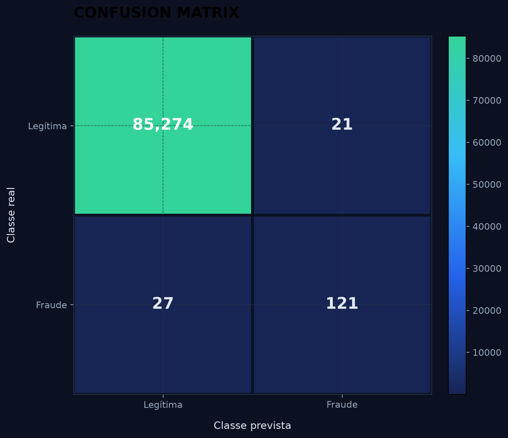
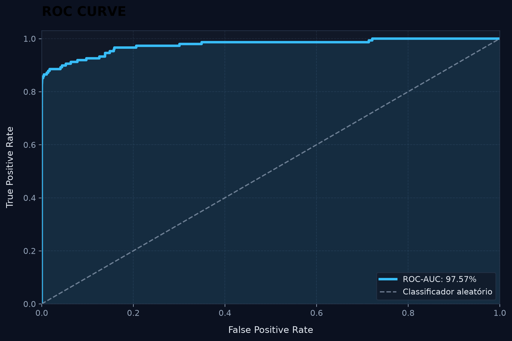
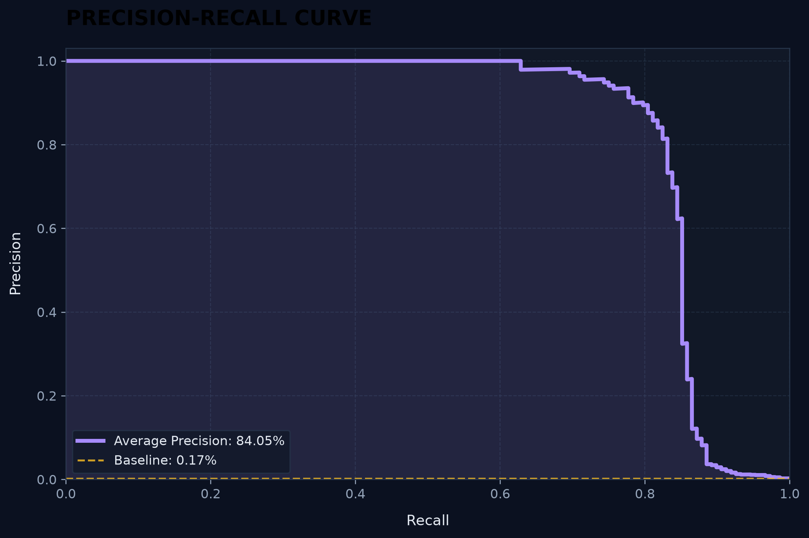
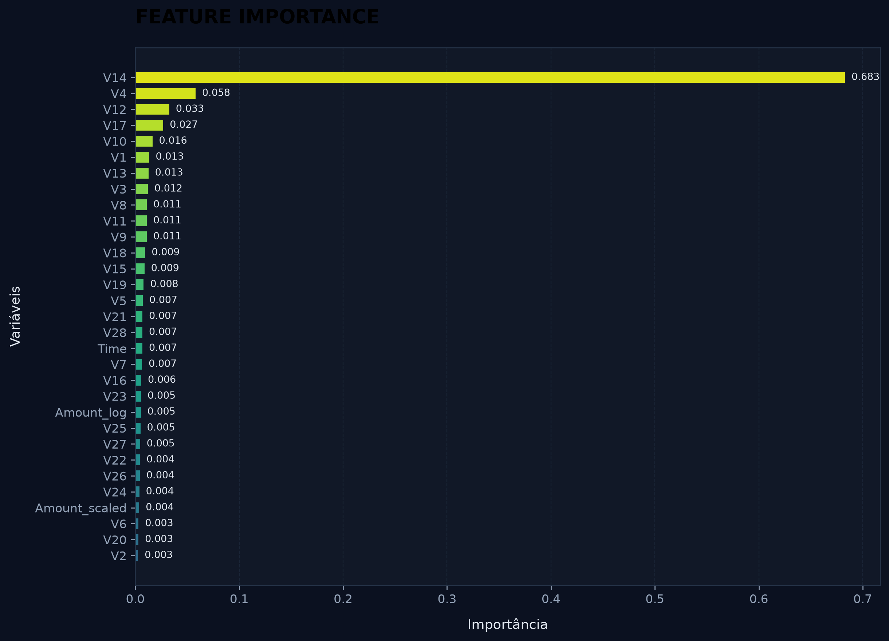
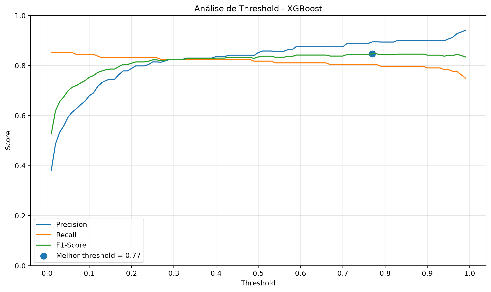
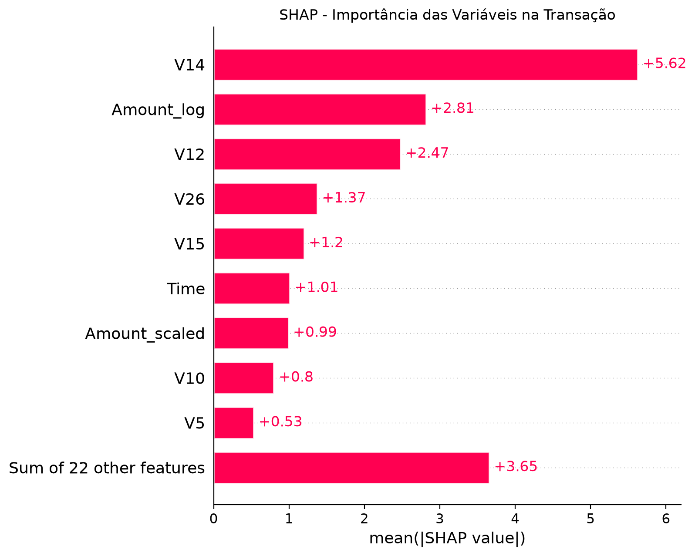

# 🛡️ Detecção de Fraudes em Cartões de Crédito com Machine Learning

Projeto de Machine Learning desenvolvido para identificar transações potencialmente fraudulentas em cartões de crédito, utilizando técnicas de análise de dados, tratamento de dados desbalanceados, treinamento de modelos preditivos e explicabilidade.

O projeto também conta com um **dashboard interativo desenvolvido com Streamlit**, permitindo explorar os resultados dos modelos, analisar métricas e avaliar diferentes thresholds de classificação.


## 🚀 Demonstração Online

**Acesse o dashboard publicado:**

[Fraud Detection Analytics — Abrir aplicação](https://deteccao-fraudes-cartao-gu2sks9hkbc4l2iw3nzeap.streamlit.app/)

O dashboard permite explorar os resultados dos modelos de Machine Learning, comparar métricas, analisar diferentes thresholds de classificação e visualizar explicações com SHAP.

**Tecnologias:** Python, Streamlit, Pandas e Plotly.


---

## 📊 Dashboard — Fraud Detection Analytics

O projeto possui um dashboard interativo para apresentar os resultados da análise e do treinamento dos modelos.

### Funcionalidades

- Visão geral dos resultados.
- Comparação entre modelos de Machine Learning.
- Análise de métricas de classificação.
- Simulação e avaliação de diferentes thresholds.
- Visualização de resultados de explicabilidade.
- Gráficos interativos com Plotly.

### Executar o dashboard

Após instalar as dependências, execute na raiz do projeto:

```bash
streamlit run dashboard/app.py
```

O Streamlit abrirá o dashboard no navegador.

---

## 🎯 Objetivo do projeto

Desenvolver um fluxo de análise e classificação de transações financeiras, buscando identificar fraudes com o equilíbrio adequado entre a detecção de operações fraudulentas e a redução de falsos positivos.

O projeto envolve:

- Análise exploratória de dados.
- Pré-processamento e transformação de variáveis.
- Tratamento do desbalanceamento entre classes.
- Treinamento e comparação de modelos.
- Avaliação de métricas de classificação.
- Otimização de threshold.
- Explicabilidade das previsões.
- Apresentação dos resultados em dashboard.

## 📁 Dataset

Foi utilizado o conjunto de dados público **Credit Card Fraud Detection**.

Características do conjunto de dados:

| Característica | Quantidade |
|---|---:|
| Total de transações | 284.807 |
| Variáveis | 31 |
| Transações fraudulentas | 492 |
| Transações legítimas | 284.315 |

A variável `Class` identifica o tipo de transação:

- `0`: transação legítima.
- `1`: transação fraudulenta.

As variáveis `V1` até `V28` correspondem a componentes transformados por PCA. O conjunto também contém as variáveis `Time` e `Amount`.

O dataset original não é versionado neste repositório. O pipeline realiza o download dos dados quando necessário.

## ⚙️ Pipeline de Machine Learning

O desenvolvimento foi organizado em etapas:

1. Carregamento dos dados.
2. Análise exploratória.
3. Verificação de valores e distribuição das classes.
4. Pré-processamento das variáveis.
5. Separação dos dados de treinamento e teste.
6. Aplicação de técnicas para lidar com o desbalanceamento.
7. Treinamento dos modelos.
8. Avaliação e comparação dos resultados.
9. Análise de threshold.
10. Explicabilidade das previsões.

### Pré-processamento

Foram utilizadas técnicas como:

- Padronização de variáveis numéricas com `StandardScaler`.
- Transformação logarítmica da variável `Amount`, com criação de `Amount_log` durante o processamento.
- Separação entre treinamento e teste.
- Balanceamento da classe minoritária com SMOTE.

### Modelos avaliados

Foram desenvolvidos e comparados três modelos:

- Logistic Regression
- Random Forest
- XGBoost

## 📈 Resultados dos modelos

Os modelos foram avaliados utilizando métricas adequadas para problemas de classificação desbalanceada.

Resultados obtidos no conjunto de teste:

| Modelo | Recall | Precision | F1-score | ROC-AUC | Average Precision |
|---|---:|---:|---:|---:|---:|
| Logistic Regression | 0,8784 | 0,0654 | 0,1217 | 0,9676 | 0,7033 |
| Random Forest | 0,8378 | 0,6139 | 0,7086 | 0,9790 | 0,7870 |
| XGBoost | 0,8176 | 0,8521 | 0,8345 | 0,9757 | 0,8405 |

### Análise dos resultados

O XGBoost apresentou o melhor F1-score, Precision e Average Precision entre os modelos avaliados.

O Random Forest obteve o maior ROC-AUC, enquanto a Regressão Logística apresentou o maior Recall.

Essa comparação demonstra que a escolha do modelo depende do objetivo da operação e do equilíbrio desejado entre fraudes detectadas e falsos alertas.

## 🎚️ Análise de Threshold

Além da comparação dos modelos, foi realizada uma análise de diferentes limiares de classificação.

O threshold padrão de 0,50 apresentou os seguintes resultados para o XGBoost:

| Métrica | Resultado |
|---|---:|
| Precision | 0,8521 |
| Recall | 0,8176 |
| F1-score | 0,8345 |

Também foi avaliado o threshold de 0,77:

| Métrica | Resultado |
|---|---:|
| Precision | 0,8947 |
| Recall | 0,8041 |
| F1-score | 0,8470 |

O ajuste do threshold permite modificar o comportamento do classificador, buscando um equilíbrio mais adequado entre precisão e capacidade de detecção.

## 🔍 Explicabilidade com SHAP

Foi utilizada a biblioteca SHAP para investigar como as variáveis influenciam as previsões do modelo.

A explicabilidade ajuda a compreender quais características contribuíram para uma classificação, tornando a análise dos resultados mais interpretável.

## 📊 Visualizações dos resultados

### Matriz de confusão



### Curva ROC



### Curva Precision-Recall



### Importância das variáveis



### Análise de Threshold



### Explicabilidade SHAP



## 🧰 Tecnologias utilizadas

- **Python:** linguagem de programação.
- **Pandas e NumPy:** manipulação e análise de dados.
- **Matplotlib:** visualização de dados.
- **Scikit-learn:** treinamento e avaliação de modelos.
- **Imbalanced-learn:** tratamento do desbalanceamento com SMOTE.
- **XGBoost:** modelo de classificação.
- **SHAP:** explicabilidade dos modelos.
- **Streamlit:** desenvolvimento do dashboard.
- **Plotly:** gráficos interativos.
- **Git e GitHub:** versionamento e documentação.

## 📂 Estrutura do projeto

```text
deteccao-fraudes-cartao/
│
├── dashboard/
│   ├── app.py
│   ├── charts.py
│   ├── metrics.py
│   └── styles.py
│
├── data/
│   └── raw/
│
├── docs/
│
├── models/
│
├── notebooks/
│   └── 01_analise_exploratoria.ipynb
│
├── results/
│   ├── metricas.csv
│   ├── threshold_analysis.csv
│   ├── threshold_analysis.png
│   ├── shap_local.png
│   ├── XGBClassifier_confusion_matrix.png
│   ├── XGBClassifier_roc.png
│   ├── XGBClassifier_precision_recall.png
│   └── feature_importance.png
│
├── src/
│
├── .gitignore
├── README.md
└── requirements.txt
```

## 🚀 Como executar o projeto

### 1. Clonar o repositório

```bash
git clone https://github.com/eltonjsilva05-spec/deteccao-fraudes-cartao.git
```

### 2. Entrar na pasta

```bash
cd deteccao-fraudes-cartao
```

### 3. Criar ambiente virtual

```bash
python -m venv .venv
```

### 4. Ativar o ambiente virtual

No Windows PowerShell:

```powershell
.venv\Scripts\Activate.ps1
```

No Git Bash:

```bash
source .venv/Scripts/activate
```

### 5. Instalar dependências

```bash
pip install -r requirements.txt
```

### 6. Executar o pipeline

```bash
python src/main.py
```

### 7. Executar o dashboard

```bash
streamlit run dashboard/app.py
```

## 💡 Aprendizados

Durante o desenvolvimento deste projeto, foram trabalhados conceitos importantes de Ciência de Dados e Machine Learning:

- Análise exploratória e preparação de dados.
- Identificação de problemas de desbalanceamento.
- Aplicação de SMOTE.
- Treinamento e comparação de algoritmos.
- Interpretação de métricas de classificação.
- Ajuste de threshold conforme o objetivo do modelo.
- Explicabilidade utilizando SHAP.
- Organização de resultados e visualizações.
- Desenvolvimento de uma interface interativa com Streamlit.

## 🔭 Possíveis evoluções

- Disponibilização do dashboard em ambiente cloud.
- Integração com uma API para disponibilizar previsões.
- Monitoramento de desempenho dos modelos.
- Atualização automatizada dos dados e métricas.
- Evolução do fluxo de processamento e implantação.

## 👨‍💻 Autor

**Elton Jhon Silva**

Estudante de Análise e Desenvolvimento de Sistemas, em transição de carreira para a área de Dados e Engenharia de Dados.

- [LinkedIn](https://www.linkedin.com/in/eltonjsilva)
- [GitHub](https://github.com/eltonjsilva05-spec)

---

*Projeto desenvolvido para fins de estudo, prática e construção de portfólio na área de Dados e Machine Learning.*